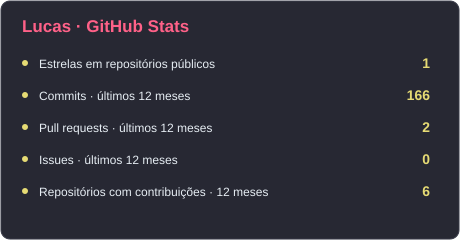
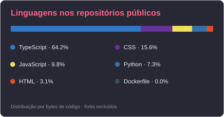

<h2>🧭 Áreas de atuação</h2>

<table>
<tr>
<td width="50%" valign="top">

### 💻 Full-stack

Interfaces, APIs e integrações conectadas em produtos completos.

`Front-end` · `Back-end` · `Integrações`

</td>
<td width="50%" valign="top">

### 🤖 IA aplicada

Agentes autônomos e chatbots corporativos com contexto e automação.

`RAG` · `LLMs` · `Agentic Workflows`

</td>
</tr>
<tr>
<td width="50%" valign="top">

### ⚙️ Automação e DevOps

Conexão entre desenvolvimento, entrega e operação do software.

`Automação` · `Entrega` · `Operação`

</td>
<td width="50%" valign="top">

### 🎨 Produto e usabilidade

Decisões técnicas guiadas pela experiência de quem usa.

`Design` · `UX` · `Visão de produto`

</td>
</tr>
</table>

<h2>🛠️ Tecnologias</h2>

### Front-end

### Back-end e APIs

### Dados e persistência

### Ferramentas e ambiente

### Aplicações mobile e desktop

### Testes e qualidade

### IA e automação

<h2>⚙️ Como trabalho</h2>

  
  
  
  

| Etapa | Na prática |
| :--- | :--- |
| 🔍 **Entender** | Partir do problema e do impacto para quem usa o produto. |
| 🧩 **Planejar** | Dividir entregas em escopos claros, com critérios de validação e revisão. |
| 🧪 **Validar** | Supervisionar agentes de IA, testar e verificar evidências das mudanças. |
| 🔗 **Integrar** | Documentar decisões e cuidar da integração entre as partes do sistema. |

<h2>🌱 Em construção e estudo</h2>

<table>
<tr>
<td width="33%" valign="top">

#### 🚀 Construindo

Projeto próprio que une engenharia, design e visão de produto.

`Software` · `Usabilidade`

</td>
<td width="33%" valign="top">

#### 🎓 Aprofundando

Estudos em IA por meio de disciplina isolada de pós-graduação na UFPE.

`Inteligência artificial` · `Estudo`

</td>
<td width="33%" valign="top">

#### 🤖 Explorando

Supervisão, organização e revisão de desenvolvimento com múltiplos agentes.

`Agentic Workflows` · `Revisão`

</td>
</tr>
</table>

<h2>📊 Estatísticas e atividade</h2>

### 🔥 Streak Stats

### 💻 GitHub Profile Stats

  
  

Dados atualizados diariamente. Linguagens representam bytes de código público, não nível de experiência. Commits, PRs e issues consideram os últimos 12 meses.

### ⚡ Atividade pública

<h2>🔎 Explore meu trabalho</h2>

  
  &nbsp;
  

<h2>🤝 Vamos conversar</h2>

Para conversar sobre engenharia de software, IA aplicada ou produtos digitais:

<!-- PORTFOLIO: Replace PORTFOLIO_URL and uncomment when the website is available.

-->

